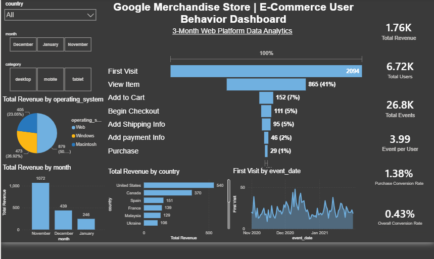
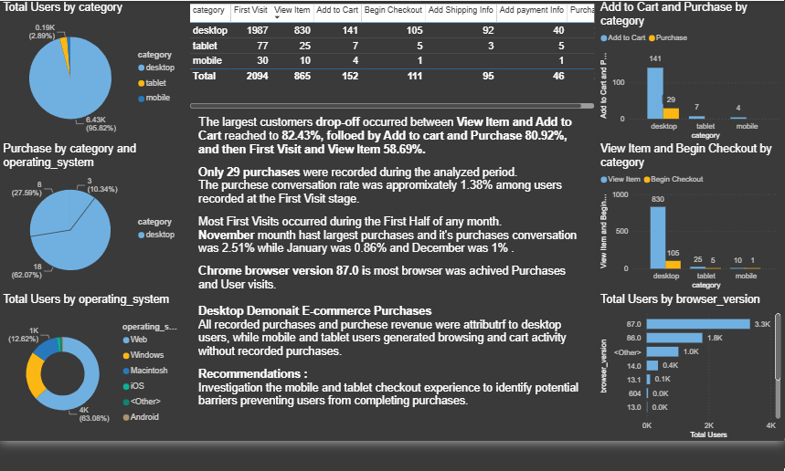

# Merchandise Store – E-Commerce User Behavior AnalGoogle ysis

## Project Overview

This project analyzes e-commerce user behavior on the Google Merchandise Store using Power BI. It explores customer engagement, purchasing patterns, conversion performance, and user behavior across different devices, operating systems, browsers, and countries.

The analysis covers three months of Google Analytics 4 sample data, from November 2020 to January 2021.

## Tools & Technologies

- Power BI Desktop
- Power Query (Data Cleaning & Transformation)
- DAX (Measures & KPIs)

## Dashboard Pages

**1. Overview**
- Key Performance Indicators (KPIs)
- E-commerce Purchase Funnel
- Revenue by Country and Month
- First Visits Over Time
- Revenue by Operating System

**2. User Behavior**

- User Distribution by Operating System and Category
- Browser Version Analysis
- Funnel Performance by Category
- Device-Based Purchasing Analysis
- Business Insights and Recommendations

## Key Business Insights

- Only 29 purchases were recorded during the analyzed period.
- Purchase Conversion Rate was approximately 1.38% among users recorded at the First Visit stage.
- The largest customer drop-off occurred between View Item and Add to Cart (82.43%), followed by Add to Cart and Purchase (80.92%), and First Visit and View Item (58.69%).
- Purchase Conversion Rate declined from 2.51% in November to 1% in December and 0.86% in January.
- Desktop accounted for all recorded purchases and purchase revenue, while mobile and tablet users generated browsing and cart activity without recorded purchases.
- Chrome version 87.0 recorded the highest user visits and purchases among the analyzed browser versions.

## Business Recommendations

- Investigate the product browsing and Add to Cart experience to identify potential barriers to purchase.
- Review the mobile and tablet checkout experience to understand the absence of recorded purchases.
- Monitor monthly conversion performance to identify changes in purchasing behavior.
- Further investigate browser and device performance to improve the overall shopping experience.

## Dataset Source

Google Analytics 4 – Google Merchandise Store public sample dataset.

Dataset: `bigquery-public-data.ga4_obfuscated_sample_ecommerce`

Period: November 1, 2020 – January 31, 2021.

The dataset contains obfuscated sample data and may have limitations in internal consistency.

## License

This project is licensed under the MIT License. The license applies to the original project materials and does not extend to Google's dataset, trademarks, or other third-party materials.
